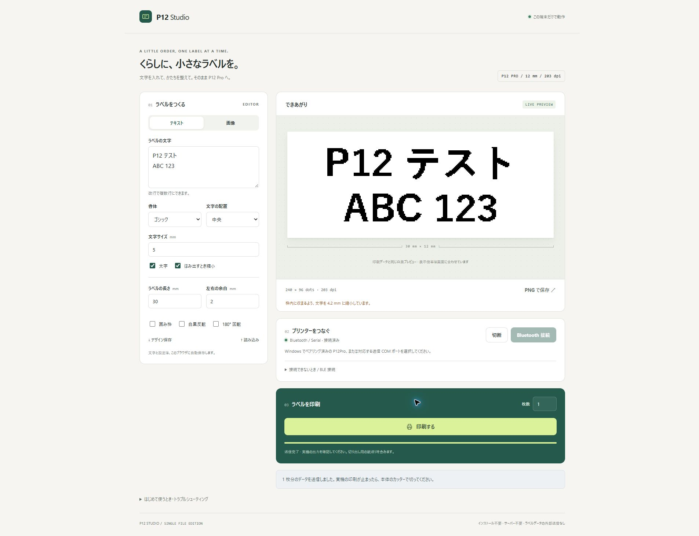
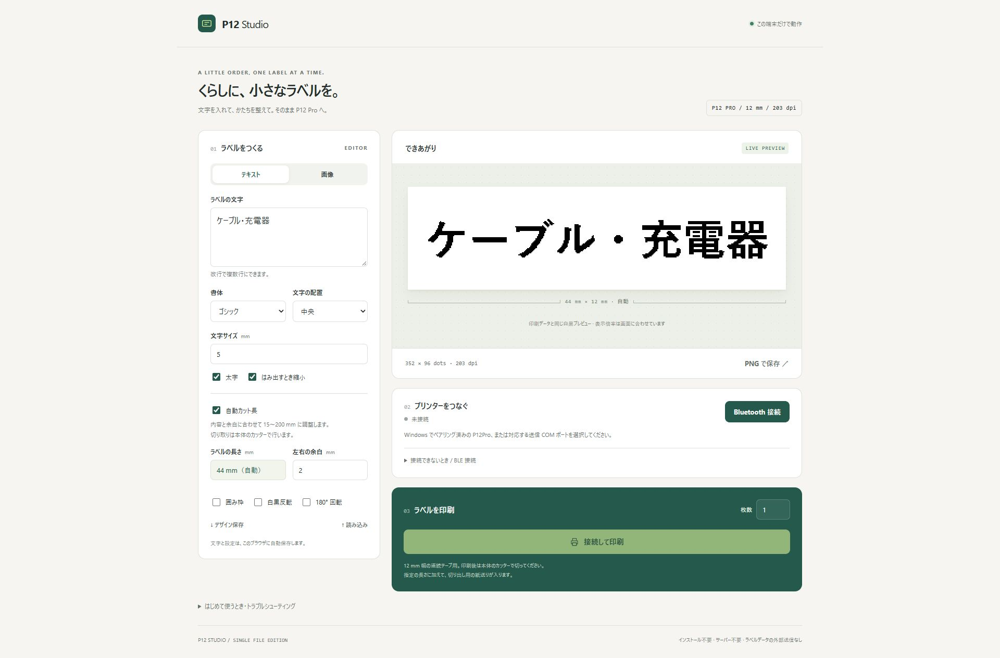

# P12 Studio

**P12 Pro へ、ブラウザから Bluetooth でラベル印刷。**

コンパイル・インストール・サーバー・外部ライブラリ不要。`index.html` ひとつで使える、日本語対応のラベル作成ツールです。

[ブラウザで使う](https://xenoah.github.io/print-on-web_p12-pro/) · [最新版をダウンロード](https://github.com/Xenoah/print-on-web_p12-pro/releases/latest) · [HTML 単体](https://raw.githubusercontent.com/Xenoah/print-on-web_p12-pro/main/index.html)



## 使い方

1. [Releases](https://github.com/Xenoah/print-on-web_p12-pro/releases/latest) の **Source code (zip)** を保存して展開します。HTML だけ取得する場合は、リリース本文の HTML リンクをファイルとして保存してください。
2. デスクトップ版 **Chrome または Edge** で、`index.html` を開きます。
3. P12 Pro の電源を入れ、Windows の Bluetooth 設定でペアリングします。
4. **Bluetooth 接続** を押し、`P12Pro` またはプリンターの送信 COM ポートを選びます。`JL_SPP（COM番号）` と表示される場合があります。
5. 文字・画像・ラベルの長さを設定し、プレビューを確認して **印刷する** を押します。
6. 印刷が止まったら、本体のカッターで切り取ります。

COM 番号は PC ごとに異なります。Print Master など、同じプリンターに接続するアプリは閉じてください。ブラウザの接続許可は、OS でのペアリングとは別に必要です。

ダウンロードせずに使う場合は、Chrome または Edge で [GitHub Pages 版](https://xenoah.github.io/print-on-web_p12-pro/) を開いてください。接続先は初回に選び直す必要があります。

## 横書き・縦書きと文字の配置

「書字方向」で横書き／縦書きを選べます。縦書きでは、文字を左へ90°回転して**プレビューの左から右へ**並べます。テキスト欄で改行すると、プレビューでは下の段に進みます。プレビュー全体は横長のままです。

縦書きへ切り替えると「自動カット長」がオンになり、**入力行の文字数が増えるほどテープが長くなります**。例えば5 mmの文字・左右余白2 mmなら、4文字で24 mm、8文字で44 mmです。複数行では最も長い行を基準にし、テープ幅に収まるよう行数に応じて文字サイズを調整します。手動で長さを指定したい場合は自動カット長をオフにできます。

「文字の配置」の左寄せ／中央／右寄せは、各入力行の位置に適用します。PNG 保存と印刷にも同じ配置を使います。書字方向・配置・自動カット長は自動保存とデザイン JSON に含まれます。書字方向のない以前のデザインは横書きで読み込み、縦書きで保存したデザインは修正後の向きで表示します。

日本語の縦組は、[W3C「日本語組版処理の要件」](https://www.w3.org/TR/jlreq/#major_differences_between_vertical_writing_mode_and_horizontal_writing_mode)で「文字は上から下に，行は右から左に配置する」とされています。本アプリは、その縦組を左へ90°回転して横長のテープに配置します。テープの左端を上にして縦に持つと、日本語の縦組の読み順になります。英数字も1文字ずつ扱い、句読点・括弧・長音符は縦組の配置方向を考慮します。

調査では [W3C 公式リポジトリの該当箇所](https://github.com/w3c/jlreq/blob/43942474f0edc0c75527eda8750761edb4503064/index.html#L847)と、[縦組と横組の約物の違い](https://github.com/w3c/jlreq/blob/43942474f0edc0c75527eda8750761edb4503064/index.html#L2129)を確認しました。

## 自動カット長

**自動カット長** をオンにすると、内容と左右余白に合わせて、ラベルの長さを 15〜2000 mm の範囲で 1 mm 単位に調整します。計算結果は長さ欄とプレビューに表示し、その長さで PNG 保存・印刷します。

- 文字は選択した書体・サイズで計算します。横書きは最も長い行の幅、縦書きは最も文字数の多い入力行の長さに合わせます。「はみ出すとき縮小」がオンなら、先にテープの高さに収めます。
- 画像はテープの高さに合わせ、画像全体の縦横比から長さを決めます。画像内の白い余白は切り詰めません。
- 上限の 2000 mm を超えると案内を表示します。文字の自動縮小をオフにしてはみ出した場合は、印刷を止めます。
- オフにすると、元の手動設定の長さに戻ります。設定は自動保存・デザインの JSON 保存にも含まれます。旧版のデザインは手動長で読み込めます。

**本体のカッターで切り取る方式です。** 自動カット長は印刷領域の長さを計算する機能で、切り出し用の紙送りは別に加わります。



## できること

- 日本語・英数字・複数行テキスト。横書き／縦書き、左寄せ／中央／右寄せ、ゴシック／明朝／等幅、太字、文字サイズの調整
- PNG・JPEG・WebP・BMP の読み込みと白黒変換
- 印刷データと同じ白黒プレビュー
- 12 mm 幅・203 dpi の連続テープに、15〜2000 mm のラベルを作成
- 文字・画像と余白に合わせた自動カット長、手動長との切り替え
- 自動縮小、余白、囲み枠、白黒反転、180° 回転
- 1〜20 枚の印刷、現在の 1 枚を送り終えてから残りを停止
- PNG 保存、画像を含むデザインの JSON 保存・読み込み
- 文字と設定のブラウザ内自動保存
- Web Serial による Bluetooth 接続、BLE 対応機向けの接続オプション
- 印刷を伴わない通信確認、通信ログの保存

## 動作確認

2026-10-21 に、Windows の Chrome から P12 Pro へ **COM13** 経由で接続し、次のラベルを実機に出力しました。

```text
P12 テスト
ABC 123
```

- 30 × 12 mm、1 枚、240 × 96 dots
- 初期化、2,880 bytes の画像データ、紙送りの送信を確認
- 使用者による実物の確認で、文字が正常に印刷されたことを確認
- JavaScript の警告・エラーなし

**実機確認済みの経路は Windows / Chrome / Bluetooth Serial です。** Edge、BLE、その他 OS・機種は実機未検証です。Firefox・Safari・iPhone/iPad からの直接印刷は対象外です。画面の自動検証は localhost 上で実施しました。

## 注意点・トラブルシューティング

- 指定したラベルの長さに加えて、切り出しのための紙送りが入ります。
- 「送信完了」は通信の完了を示します。テープ切れなどを含む実機の印刷完了までは保証しません。
- 途中で通信が切れた場合は、自動再送しません。プリンターの電源を入れ直してから再接続してください。
- 接続画面が出ない場合は、このタブを前面に出してから接続ボタンを押してください。
- ポートを開けない場合は、ほかの印刷アプリを終了し、送信側の COM ポートを選び直してください。
- 画像は自動保存されません。画像も残す場合は「デザイン保存」を使ってください。
- 文字の見た目は、利用端末にインストールされているフォントに依存します。

## データの扱い

ラベルの編集・画像処理はブラウザ内で行います。CDN、解析サービス、外部 API への送信はありません。文字と設定は `localStorage` に保存し、印刷データは選択したプリンターへ送ります。

通信ログには機器の製造番号などが含まれる場合があります。ログを公開するときは内容を確認してください。

## 開発・テスト

編集対象は `index.html` です。HTML・CSS・JavaScript をすべて同ファイルに含めています。

通信処理の回帰テストは、Node.js の標準機能のみで実行できます。**通常の利用に Node.js は不要です。**

```sh
node tests/protocol.test.cjs
```

36 項目で、縦書きのサイズ計算・結合文字・設定互換性、自動カット長の計算・上下限・複数行・画像・設定の互換性、ラスターの回転・ビット配置、ヘッダー、応答待ち、接続の後片付け、複数枚印刷、停止、通信エラー、空ラベル、接続確認中の操作競合を検証します。このテストから実機に印刷は行いません。

縦書きの描画・配置・PNG 保存・印刷ラスター・JSON の互換性・モバイル画面のブラウザ検証には、Playwright と Chromium が使える開発環境で次を実行します。既定の Chromium は `/usr/bin/chromium`、別の場所なら `CHROMIUM_PATH` で指定できます。模擬描画の確認で、実機には印刷しません。

```sh
node tests/text-layout.browser.cjs
```

Android の Chrome では「BLE でデバイスを探す」から接続します（HTTPS 上で利用してください）。BLE は応答なし書き込みに対応する機器ではその方式を優先し、20 バイト以下のパケットを順番に送ります。印刷データの待ち時間は 120 バイトごとに設け、20 バイトごとの待機による供給速度の低下を抑えています。応答付き書き込みのみの機器にも対応します。BLE の送信 API に渡すデータ順序・バイトの一致・再送しない動作・切断時の中断・印刷全体の待機時間を自動テストで確認しています。プリンター側での受信を保証するテストではありません。Android / BLE の実機での印字品質は未検証です。

BLE の送信信号を仮想時計・独立した画像デコーダーで解析するには、次を実行します。実機には接続せず、送信 API の所要時間を変えた比較、受信バッファの仮説モデル、途中失敗・タイムアウトを検証します。

```sh
node tools/analyze-ble.cjs --output /tmp/p12-ble-analysis.json
```

解析結果と制限は [BLE 送信解析](docs/ble-signal-analysis.md) を参照してください。実際の端末では、BLE 印刷後に「通信ログを保存」で取得できる `BLE raster host:` 行に、送信 API 完了バイト数・回数・時間・最大待ち時間を記録します。これはブラウザ側の計測であり、電波キャプチャーやプリンター受信確認ではありません。

自動カット長は Chrome でも、文字量による長さの変化、最小 15 mm、手動長への復帰、再読み込み後の設定復元を確認しています。

最大 2000 mm は、Chrome での表示・設定復元と、15,984 × 96 dots / 191,808 bytes の印刷データ生成を検証済みです（[確認画面](docs/images/max-length-2000.jpg)）。実機での 2 m の出力は未検証です。

```text
index.html                 実行に必要な唯一のファイル
docs/images/p12-studio.png  実機テスト後の画面
docs/images/auto-cut-length.jpg  自動カット長の画面
docs/images/max-length-2000.jpg  最大 2000 mm の確認画面
tests/protocol.test.cjs     通信処理の回帰テスト
```

## 通信仕様の参考

- [PepperPhil/phomemo_p12](https://github.com/PepperPhil/phomemo_p12)
- [transcriptionstream/phomymo](https://github.com/transcriptionstream/phomymo)
- [Chrome: Serial over Bluetooth on the web](https://developer.chrome.com/blog/serial-over-bluetooth/)

メーカー公式のアプリではありません。P12 Pro 用の公開されている通信実装を参考にしています。
