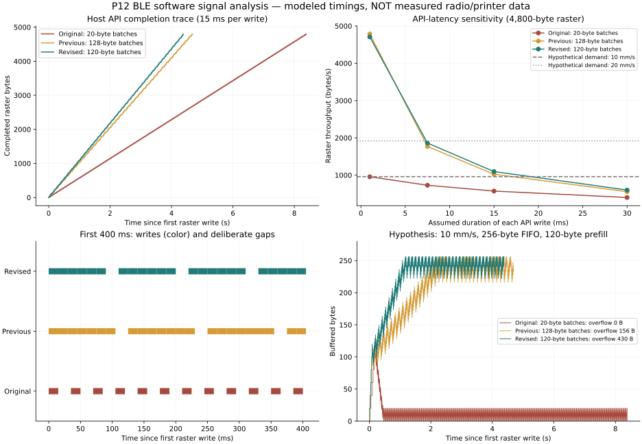
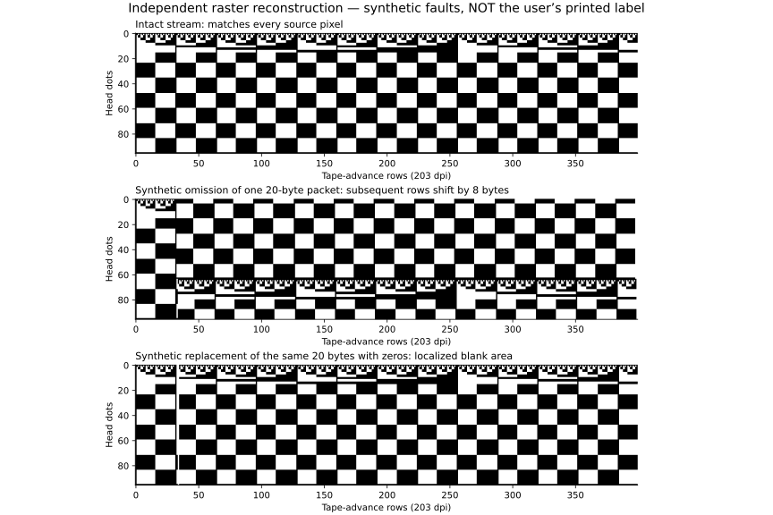

# Android / BLE の白い筋・文字欠けの再調査

今回の解析で確認したのは、ブラウザが生成するバイト列、送信 API の呼び出し順序、指定した仮想時間での動作です。**ユーザーの Android と P12 Pro の電波・HCI・印刷ヘッド信号は取得していません。白い筋の実機原因は未確定です。** このクラウドには Bluetooth アダプターもありません。

前回の「データ供給が途切れる」という説明は原因候補です。白い筋だけから確定できる説明ではありません。受信バッファやプリンターの速度・空になったときの動作は未測定であり、送信速度を上げれば必ず直るとはいえません。

## 解析方法

`tools/analyze-ble.cjs` が実際の `index.html` の `BleTransport.send` と `printLabels` を実行します。タイマーと GATT 書き込みの完了時間だけを置き換え、初期化・ヘッダー・画像・紙送りを記録します。実時間を短縮するために仮想時計を使用します。Promise の処理を進めてから次のタイマーに移り、未完了処理やタイマーの残留も検出します。

画像は全黒、全白、行番号と市松模様を含む診断用パターンの3種類。幅は1、5、10、11、399、400、401、15,984行の8種類で、パケット・バッチ・最大長の境界を調べます。短い幅や全白は低レベルの試験入力であり、通常の UI で印刷可能なラベルとは限りません。

送信画像を別のデコーダーで読み直し、元の画像と全画素を比較します。送信側の `buildRaster` を期待値の生成には使用しません。これは「同じ関数で作った期待値と比較するだけ」の検証を避けるためです。

## バイト列・プロトコルの結果

- 元のコード、前回の修正版、今回の修正版とも、24種類の画像／長さで全画素が一致しました。
- 96 dots = 12 bytes/行、黒=1、MSB-first、時計回りの回転、16-bit little-endian の行数を確認しました。
- 400 × 96 dots の画像は4,800 bytes。ヘッダーは `1b 40 1d 76 30 00 0c 00 90 01`、末尾の紙送りは `1b 64 0d` を2回です。
- 初期化の6パケットは、公開 P12 実装が Android の Print Master から取得したと記載している列と一致しました。その公開実装自体の接続は RFCOMM/Serial です。BLE の実機キャプチャーを入手したわけではありません。
- 同じ診断画像のラスター SHA-256 は3版で共通です：`903dd1517457193deaeb84de3ad8af7b2a07528ffffcbac339e664fd456211f2`。

以上から、調べた入力に関して、回転やパケット分割そのものが送信データに白い筋を生成する問題は再現しませんでした。生成データの一致は、実機でそのデータがすべて受信・印字された証明ではありません。

## 送信時系列の結果

下表は400 × 96 dots、4,800 bytes、1回の書き込み API に15 msかかると**仮定したシミュレーション**です。開始は最初の画像書き込み、終了は最後の画像書き込み完了です。初期化・ヘッダー・最後の20 ms待機・紙送りは含みません。

| 実装 | バッチ | 画像の書き込み回数 | 画像内の明示的な待機合計 | 画像送信時間 | 送信速度 |
| --- | ---: | ---: | ---: | ---: | ---: |
| 元のコード (`50cead9`) | 20 bytes | 240 | 4,780 ms | 8,380 ms | 573 B/s |
| 前回の修正 | 128 bytes | 263 | 740 ms | 4,685 ms | 1,025 B/s |
| 今回の修正 | 120 bytes | 240 | 780 ms | 4,380 ms | 1,096 B/s |

128 bytes を20 bytes以下に分けると、`20×6 + 8` の7回になります。最後の64-byteバッチも4回の書き込みを必要とし、合計263回でした。120 bytesなら `20×6` の6回で、10行分にも一致します。4,800 bytesでは23回の余分な呼び出しを除けます。これは受信機が行境界でパケットを受け取る必要がある、という意味ではありません。ストリーム中の行がパケット境界をまたいでも、全バイトが届けば復元できます。

全長で必ず高速になるわけでもありません。書き込みが1 msなら、前回1,003 ms、今回1,020 msと今回が17 ms遅くなります。15 msでは305 ms、30 msでは650 ms短くなります。今回の目的は、最小 MTU に収まる送信と順序を保ち、余分な短いパケットを減らすことです。

応答付き／応答なしのどちらも同じ時間がかかる条件と、15 ms／1 msの非対称な条件を分けました。Android の実際の完了時間や BLE 接続間隔がこの値であるとは仮定していません。応答なしを選ぶだけで何倍にも速くなる保証はありません。



## 受信バッファの仮説モデル

実機の仕様値が不明なので、速度5／10／20 mm/s、容量64／256／1,024 bytes、初期蓄積120 bytes（容量が小さければ容量まで）で感度分析しました。書き込み完了時に全データが到着し、一定速度で消費され、バッファがあふれた分は失われるモデルです。実機のフロー制御や、データ不足時にモーターを止める動作は含んでいません。

203 dpi・96 dotsのテープを10 mm/sで動かす場合、必要な画像データは約959 B/s、20 mm/sなら約1,918 B/sです。この速度は計算例であり、P12 Proの実測値ではありません。

15 ms/書き込み・容量256 bytes・10 mm/sの仮説では、元の実装は送信中に約3.21秒分の供給不足、前回修正は約156 bytes、今回修正は約430 bytesのあふれがモデル上で生じます。別の速度・容量では結果が変わります。**このモデルは不足／あふれのどちらも候補になることを示すためのもので、実機の欠落量や白い筋を再現した結果ではありません。** 送信をさらに速くする変更や未知の濃度・熱量コマンドは、この解析から正当化できません。

## 欠落を人工的に入れた画像復元

20-byteパケットを1個除去し、残りを連結して復元すると、20 mod 12 = 8 bytes分だけ後続の行境界がずれます。末尾の不足分は図のために0で補っています。これは局所的な白い筋だけでなく、その後の画像全体の位置ずれを生みます。

一方、同じ20 bytesを削除せず0に置き換えた場合は、その部分だけが白くなり、後続の行境界は保たれます。この違いは、実物の症状を観察するときの判断材料になります。どちらの図もユーザーの実機画像ではありません。



白い筋の向き・間隔、文字の位置ずれ、元の PNG にも欠けがあるかが未確認です。ヘッドやテープなど印刷機構の問題、受信側の動作、端末の送信間隔を、現時点では切り分けられません。

## 追加した診断と検証

BLE 画像送信時に `performance.now()` で測定し、既存の「通信ログを保存」に次を記録します。

- 画像の期待バイト数と、書き込み API が正常完了したバイト数
- 書き込み回数と選んだ書き込み方式
- 最初の書き込み開始から最後の書き込み終了までの時間・平均 B/s
- 書き込み所要時間の平均・最大、書き込み間の待ち時間の最大
- 完了／途中失敗の区別と、プリンター側の受信は未確認であること

生のラベル画像をログへ追加したり、毎パケット DOM を更新したりはしません。タイムアウトや途中切断でも、それまでの統計を残します。API 完了を印刷完了と扱わず、書き込みが失敗した場合の再送も行いません。

検証したもの：

1. 既存の回帰テスト29項目。
2. 画像復元24ケース、時間／書き込み方式6ケース。
3. 3パケット目での拒否、受け渡し後の拒否、切断、8秒タイムアウトの4ケース。いずれも続き・再送・紙送りを止め、接続を閉じて操作中状態を解除します。
4. 診断ログの完了バイト数・回数・時間が、独立した送信記録と一致すること。失敗／タイムアウト時も検証します。
5. スマートフォン画面幅の Chromium と模擬 GATT で、デバイス探索・通知・接続・日本語プレビュー・印刷・全画素復元・診断ログを確認。応答なし／応答付きの両方を通し、ページエラーはありません。これは Android 実機での動作検証ではありません。

## 再実行

Node.js の標準機能だけで実行できます。

```sh
node tests/protocol.test.cjs
node tools/analyze-ble.cjs --output /tmp/p12-ble-current.json

git show 50cead9:index.html > /tmp/p12-before-ble-fix.html
node tools/analyze-ble.cjs --html /tmp/p12-before-ble-fix.html --baseline --output /tmp/p12-ble-original.json
```

`--baseline` は古い版について修正後の失敗処理を要求しない比較用です。バイト／画像／時間の検証は実行されます。結果にはソースの SHA-256、仮定した時間、パケットの開始・終了時刻とバイト列、受信バッファの仮説計算を含みます。バイト列は人工パターンです。

BLE 解析時点の3版の集計とソースの SHA-256 は [ble-summary.json](analysis/ble-summary.json) に保存しました。「前回修正」は128-byteバッチを使った調査中の比較用スナップショットです。以後の縦書き対応による変更は、この過去の集計には含みません。

## 実機原因の確定に必要なデータ

実際の Android で修正版を印刷した通信ログがあれば、端末側の送信間隔をこの仮説値と置き換えられます。受信欠落まで調べるには、端末の Bluetooth HCI snoop log と同じ内容の出力が必要です。HCI の Write Command の時刻やバイト列でも、無応答書き込みのプリンター受信までは直接証明できません。Print Master からの正常な印刷の HCI 記録があれば、初期化・データのまとまり・フロー制御の差を比較できます。

この報告は BLE 修正の調査時点の記録です。Android / BLE の実機での改善確認は未実施です。

## 参照した仕様と実装

- [Web Bluetooth: WriteCharacteristicValue](https://webbluetoothcg.github.io/web-bluetooth/#writecharacteristicvalue)：応答の有無による手続きの違い、非同期処理、操作の直列化。`writeValueWithoutResponse` の成功は印字の保証ではありません。
- [soburi/phomemo_p12 `print_p12.py`](https://github.com/soburi/phomemo_p12/blob/3c1bf0d4237c92321a51f600c66bdc0b5640e529/phomemo/print_p12.py)：P12 の初期化・画像ヘッダー・紙送り。
- [phomymo `printP12`](https://github.com/transcriptionstream/phomymo/blob/1f58d3f0e7f941b9143277cda828380149e56855/src/web/printer.js#L729)：128-byte送信と20 ms待機。
- [phomymo BLE transport](https://github.com/transcriptionstream/phomymo/blob/1f58d3f0e7f941b9143277cda828380149e56855/src/web/ble.js)：応答なし書き込みの選択。ただし参照実装は128 bytesをそのまま渡します。本アプリでは MTU を取得できないため20 bytes以下を維持します。参照実装の再送フォールバックは、二重送信になる可能性があるため採用していません。
